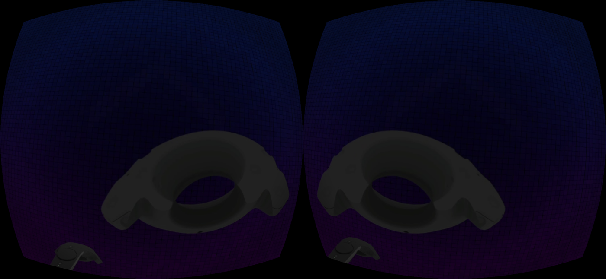
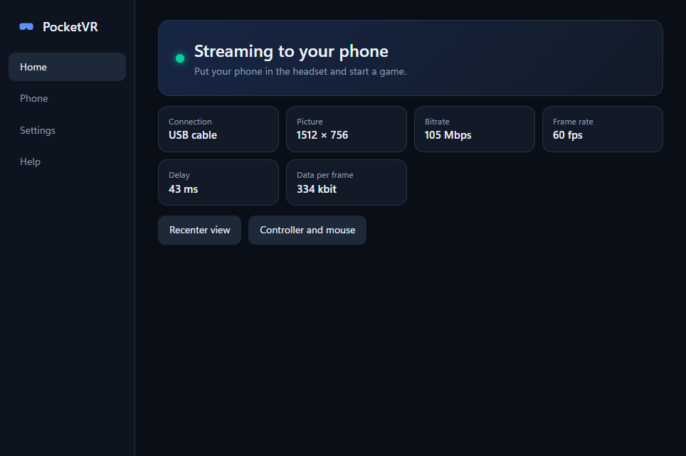
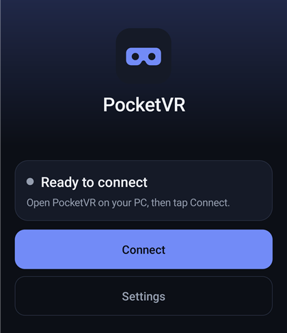
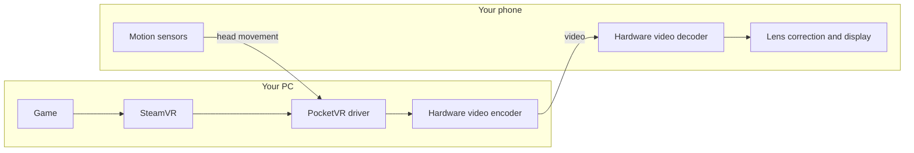

# PocketVR

### Play PC VR games on your Android phone. Free and open source.

**Turn your phone and a cheap Cardboard headset into a SteamVR headset, over USB or Wi-Fi.**

[**Download**](#download) · [**Install guide**](#quick-start) · [**How it works**](#how-it-works) · [**FAQ**](#faq)

---

PocketVR streams SteamVR games from your Windows PC to your Android phone. Your PC runs the game, and your phone becomes the VR screen and head tracker. Put the phone in any Google Cardboard-style headset and you have PC VR without buying a VR headset.

**No accounts. No time limits. No watermarks. No licence checks. No telemetry.**

> **Early software.** It works, but it has only been tested on one setup so far. See [What has been tested](#what-has-been-tested) before you expect too much.

---

## What it is

A real VR headset can be expensive. Your phone already has a sharp screen and motion sensors, and your PC already has the graphics power. PocketVR connects the two.

There are two parts:

- **PC app:** adds a virtual headset to SteamVR and streams the game to your phone.
- **Phone app:** shows the picture for each eye and sends your head movement back to the PC.

You can look around freely, and your PC controllers, joystick or gamepad keep working as normal. Game sound plays from your PC.

### Features

- **SteamVR games on your phone:** PocketVR appears to SteamVR as a normal headset
- **USB or Wi-Fi:** USB tethering, adb or wireless, chosen automatically
- **Hardware video:** H.264 or HEVC through AMD AMF, NVIDIA NVENC or Media Foundation
- **Low-delay design:** late head-movement correction on the phone keeps turns feeling quick
- **Automatic quality:** bitrate adjusts itself to your connection
- **Cardboard lens support:** scan your headset's QR code or set the lenses by hand
- **Flight sim friendly:** works alongside joysticks, throttles and gamepads
- **Private by design:** encrypted streaming on your local network, with no cloud or account

&nbsp;

---

## Download

| For | Download | Notes |
|---|---|---|
| **Windows PC** | [PocketVR-0.1.0-x64-setup.exe](https://github.com/saimystry/PocketVR-Open/releases/latest/download/PocketVR-0.1.0-x64-setup.exe) | Includes the phone app, so this may be all you need |
| **Android phone** | [PocketVR-0.1.0.apk](https://github.com/saimystry/PocketVR-Open/releases/latest/download/PocketVR-0.1.0.apk) | Only needed if you install the phone app by hand |

All versions and file checksums are on the [Releases page](https://github.com/saimystry/PocketVR-Open/releases).

### What you need

- **PC:** Windows, a graphics card that can run SteamVR, and [SteamVR](https://store.steampowered.com/app/250820/SteamVR/) from Steam
- **Phone:** Android 10 or newer with a gyroscope
- **Headset:** any Cardboard-style phone headset
- **Connection:** a USB cable (recommended), or 5 GHz Wi-Fi with both devices on the same network

---

## Quick start

Setup takes about 10 minutes the first time. After that, you only need [step 4](#step-4-play-a-game).

### Step 1: Install on your PC

1. Install [SteamVR](https://store.steampowered.com/app/250820/SteamVR/) from Steam, and open it once.
2. Download and run [the PocketVR installer](https://github.com/saimystry/PocketVR-Open/releases/latest/download/PocketVR-0.1.0-x64-setup.exe).
3. If Windows shows **Windows protected your PC**, choose **More info**, then **Run anyway**. This appears because the installer isn't commercially signed.
4. Approve the firewall prompt, so your phone can reach the PC.
5. Open **PocketVR** from your desktop.

### Step 2: Install on your phone

Choose one way.

**Option A: from your PC (easiest)**

1. On your phone, open **Settings**, then **About phone**, and tap **Build number** seven times.
2. Go back to **Settings**, open **System**, then **Developer options**, and turn on **USB debugging**.
3. Plug your phone into the PC with a USB cable, and tap **Allow** on the phone.
4. In PocketVR on your PC, open **Phone** and click **Install on phone**.

**Option B: by hand**

1. On your phone, download [the APK](https://github.com/saimystry/PocketVR-Open/releases/latest/download/PocketVR-0.1.0.apk) and open it.
2. If asked, allow your browser to install apps, then tap **Install**.

> If you already have an older PocketVR, uninstall it first. This erases its saved lens settings.

### Step 3: Choose how to connect

| Connection | How to set it up | Best for |
|---|---|---|
| **USB cable** (recommended) | Plug in the phone with USB debugging on. PocketVR does the rest. | Lowest delay and the most stable picture |
| **USB tethering** | Plug in the phone, then turn on **USB tethering** in its hotspot settings. | The best USB option, if your phone has it |
| **Wi-Fi** | Put the PC and phone on the same network, ideally 5 GHz. Wired Ethernet on the PC helps. | No cable |

PocketVR picks the best available connection on its own.

### Step 4: Play a game

1. In PocketVR on your PC, click **Start SteamVR**, and wait for it to open.
2. Open PocketVR on your phone and tap **Connect**.
3. If the PC app says **A new phone wants to connect**, check it's yours and click **Allow**. You only do this once.
4. On the phone, tap **Enter VR**. You should see two side-by-side pictures.
5. Put the phone in your headset, either way round, and look straight ahead.
6. Start your game from Steam or your desktop. If it has a VR setting, turn that on in the game.
7. When the game loads, face forward and press **Ctrl+Alt+R** on your PC keyboard to centre your view.

Keep the PC app open while you play. It shows your connection, picture size, bitrate and delay.

### Step 5: Get the best picture

**Fit your headset:** on the phone, open **Settings**. Under **Headset**, tap **Scan headset QR code**. If your headset has no code, tap **Adjust lenses by hand**, then change the sizes until both eyes line up.

**Adjust the quality:** in the PC app, open **Settings** and choose a level:

| Setting | Choose it when |
|---|---|
| **Smooth** | You want the lowest delay |
| **Balanced** | You're starting out |
| **Sharp** | You're on USB and want the best picture |

Profiles for War Thunder, Lowest delay and Best picture are there too. They're starting points, so adjust them to suit you.

### Stopping and removing

- **To stop:** on the phone, tap **Disconnect**, then close SteamVR.
- **To update:** install the new version on the PC, then click **Install on phone**. The PC and phone apps must be the same version.
- **To uninstall:** remove PocketVR in Windows **Settings** under **Apps**, then uninstall the phone app.

---

## Controls

| To do this | Press |
|---|---|
| Recentre your view | **Ctrl+Alt+R** on the PC keyboard |
| Recentre with a gamepad | **Back** on an Xbox pad (with **Controller and mouse** open in the PC app) |
| Open the in-headset menu | **Ctrl+Alt+M**, or **Back + Start** on an Xbox pad |
| Move around that menu | **Ctrl+Alt+Arrow keys**, or the D-pad |

Recentring corrects left and right only.

---

## How it works

1. **Your phone tracks your head.** Its gyroscope and accelerometer measure how you turn, hundreds of times a second, and send that to the PC.
2. **SteamVR sees a headset.** PocketVR appears as a normal VR headset, so games work as usual.
3. **The game draws both eyes.** PocketVR combines them into one side-by-side picture.
4. **Your graphics card compresses it.** Video is encoded in hardware as H.264 or HEVC, using AMD AMF, NVIDIA NVENC or Windows Media Foundation.
5. **The video travels to your phone.** It goes over USB or Wi-Fi, encrypted. Lost packets are repaired with error correction, so nothing has to wait for a resend.
6. **Your phone shows it.** The phone decodes the video and bends the picture to suit your lenses. It also shifts the image using your very latest head position, which keeps head turns feeling quick.

PocketVR adjusts bitrate on its own, and only lowers resolution if frames are really being lost.

### Is it secure?

Each session uses signed identities and fresh encryption keys, and the video and controls are encrypted. The PC only listens on your local network. The first phone connects while the PC app is open, and any other new phone needs one click on **Allow**. A phone on the USB cable is always accepted.

---

## What has been tested

So you know what to expect, here's what has really been run.

**Tested setup:** AMD RX 590, Ryzen 5 5600, Google Pixel 4a, SteamVR and War Thunder.

| Measured over USB, in the SteamVR home scene | Result |
|---|---|
| Frame rate | Steady 60 fps at 2160×1080 |
| 4-minute stability run | No disconnects or resolution changes |
| Total delay (median) | About 72–89 ms |

**Not yet proven:**

- A full 30-minute play session
- NVIDIA and Intel graphics cards: the code exists, but it has never run on them
- HEVC video: use H.264 for now
- Other phones and other headsets
- **A PC that has never used ALVR.** On the test PC, War Thunder's view was corrected using room data ALVR had left behind. If your game looks upside down, please [open an issue](https://github.com/saimystry/PocketVR-Open/issues).

**Not planned for now:** phone audio, 6DoF position tracking and 90/120 Hz.

---

## Troubleshooting

| Problem | Try this |
|---|---|
| The phone can't find the PC | Make sure SteamVR is running. Then open **Help** in the PC app and click **Repair firewall**. |
| The picture stays black | Open **Help** in the PC app and click **Restart SteamVR**. |
| The view points the wrong way | Press **Ctrl+Alt+R**. |
| The picture looks blocky | Use a USB cable. In the PC app, open **Settings** and choose **Sharp**. |
| The phone says it's a different PC | On the phone, open **Settings** and tap **Forget this PC**. |
| The phone says to update the app | The phone app and PC app must be the same version. Click **Install on phone**. |
| The phone app won't install over an older one | Uninstall the old app first. This erases its saved lens settings. |

To report a bug, open **Help** in the PC app, click **Save a support file**, and attach it to an [issue](https://github.com/saimystry/PocketVR-Open/issues).

---

## FAQ

**Can I play PC VR games on my phone?**
Yes. Your PC runs the game through SteamVR and streams it to your Android phone. Your PC still needs to be able to run the game.

**Do I need a real VR headset?**
No. Any Cardboard-style phone headset will do.

**Does it work wirelessly?**
Yes, over Wi-Fi. A USB cable is more reliable and is recommended. For Wi-Fi, use 5 GHz.

**Does it work with War Thunder?**
Yes. War Thunder has run on the tested setup. A full 30-minute session is still being proven.

**Which games work?**
It's built for SteamVR games, using both OpenVR and OpenXR. Only SteamVR home and War Thunder have been tried so far, so please report what works for you.

**Can I walk around?**
No. PocketVR tracks head rotation only (3DoF), which suits seated games such as flight and racing sims.

**Is it really free?**
Yes. It's Apache-2.0 open source, with no paid version or limits.

**How is it different from ALVR, VRidge or iVRy?**
Those are other ways to play PC VR. PocketVR is a clean-room, open-source project built for phones in Cardboard-style headsets. It's much younger than those projects, so try whichever suits your setup.

**Does it work on iPhone?**
No, only Android 10 or newer.

---

## Build it yourself

- [Development guide](docs/DEVELOPMENT.md): tools and build steps
- [spec.md](spec.md): what it does, its status and what's left
- [Decisions](docs/DECISIONS.md): why things work the way they do
- [Protocol](docs/PROTOCOL.md): how the PC and phone talk

Bug reports and pull requests are welcome. See [CONTRIBUTING.md](CONTRIBUTING.md).

If PocketVR is useful to you, a star helps other people find it.

## Licence

PocketVR is licensed under [Apache-2.0](LICENSE). See [NOTICE](NOTICE) and [THIRD_PARTY_NOTICES.md](THIRD_PARTY_NOTICES.md) for the components it uses.

PocketVR is an independent project. It isn't affiliated with Valve, Google, AMD, NVIDIA or Gaijin Entertainment.
